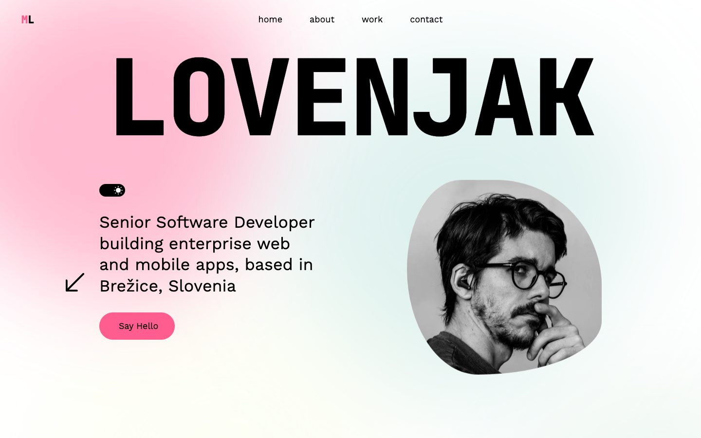
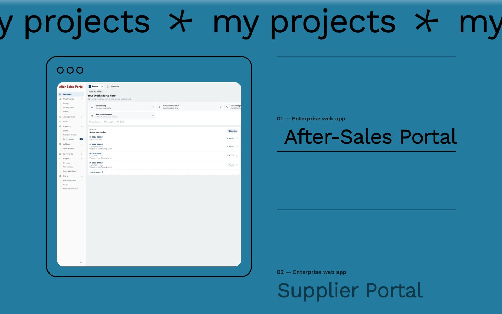
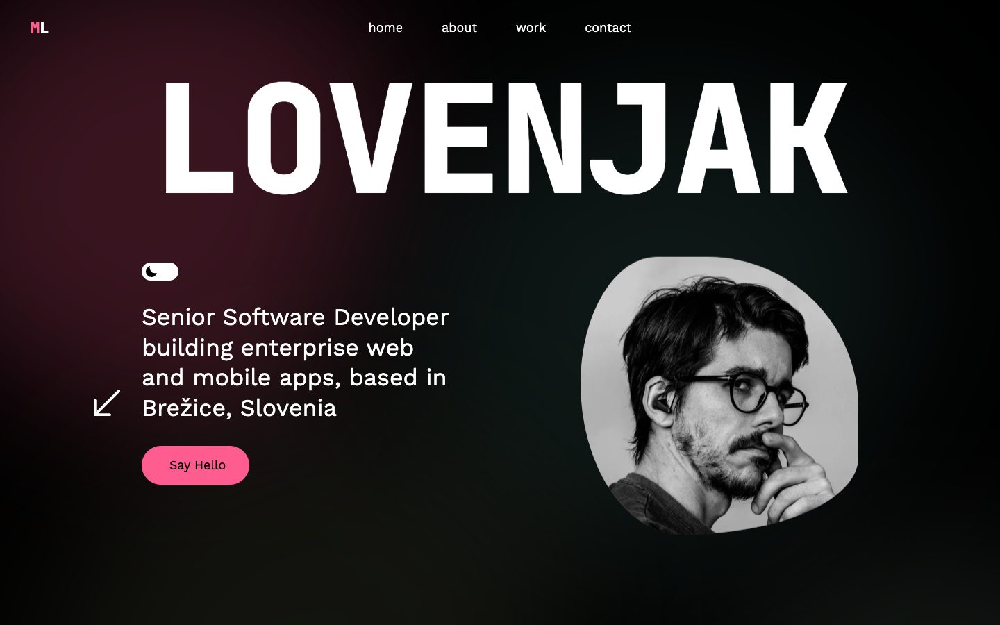

# Matjaž Lovenjak – Portfolio



Personal portfolio of a Senior Software Developer building enterprise web and mobile apps with Angular, React, React Native and TypeScript.

**Live:** [lovenjak.vercel.app](https://lovenjak.vercel.app/)

<p>
  
  
</p>

## Features

- **Intro** – the LOVENJAK letters rise and a curtain lifts; click the **ML** logo to replay it
- **About** – cards that scrub sideways while the section is pinned (a swipe strip on phones), with CV download, socials and hobbies
- **Projects** – a sticky device frame that follows the project you scroll to; screenshots wipe in and the section color crossfades
- **Motion** – smooth scrolling, scroll-linked reveals, magnetic buttons, a labelled cursor, a scroll-reactive marquee and an ambient blurred-blob background
- **Dark mode** – follows the system setting and remembers your choice
- **Accessible** – keyboard-friendly (visible focus everywhere, details open on focus), 44px touch targets, and with `prefers-reduced-motion` the page is fully static

## Tech stack

- [React 19](https://react.dev/) + TypeScript
- [Vite 8](https://vite.dev/)
- [Tailwind CSS 4](https://tailwindcss.com/)
- [Lenis](https://github.com/darkroomengineering/lenis) for smooth scrolling
- Vercel Web Analytics + Speed Insights (cookieless, so no consent banner is needed)

There is no animation library. Motion lives in `src/motion/`:

| File                                                | What it does                                                                                                                                |
| --------------------------------------------------- | ------------------------------------------------------------------------------------------------------------------------------------------- |
| `MotionProvider.tsx`                                | One `requestAnimationFrame` loop for the whole site (Lenis, scroll velocity, frame subscribers), the intro timeline and anchor-link gliding |
| `Reveal.tsx`, `useReveal.ts`                        | Line, block, image and per-letter reveals: CSS transitions started by an IntersectionObserver after the intro                               |
| `AmbientBackground.tsx`                             | The blurred color blobs; toggle with `AMBIENT_BG` in `tokens.ts`                                                                            |
| `Magnetic.tsx`, `Cursor.tsx`, `VelocityMarquee.tsx` | Pointer and scroll effects                                                                                                                  |
| `motion.css`                                        | Timings and easings; the easing tokens are in `@theme` in `src/index.css`                                                                   |

Scroll- and pointer-linked values are written straight to the DOM, so scrolling never re-renders React.

## Getting started

```bash
npm install
npm run dev       # start the dev server
npm run lint      # ESLint (flat config) on the TypeScript sources
npm run build     # type-check and build to dist/
npm run preview   # serve the production build locally
```

Requires Node 20.19+ (Vite 8).

## Project structure

```
public/            CV, favicon and link-preview image (served as-is)
src/assets/        portrait, project screenshots and video
src/components/    page sections (Hero, About, Projects, Contact, Footer, nav)
src/hooks/         small media-query hooks
src/motion/        motion system (see above)
docs/              README screenshots
```

To update the CV, replace `public/CV_Lovenjak.pdf`; its URL stays the same.

## Notes

- TypeScript is held at 5.9: typescript-eslint does not support TypeScript 6+ yet.
- Internal company projects are shown with anonymized screenshots and generic names.

See [CHANGELOG.md](CHANGELOG.md) for what changed between versions.
